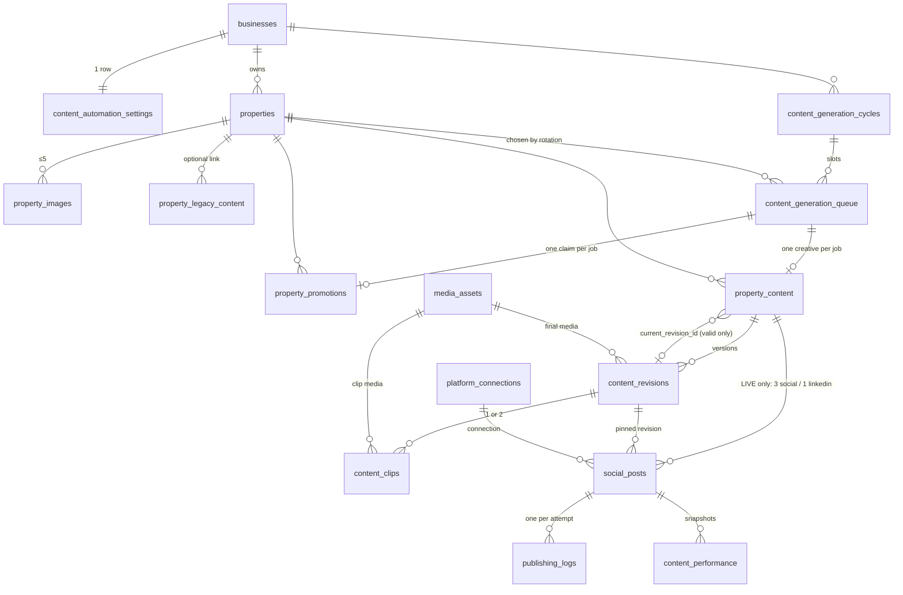

# Content Automation — Data Model & Safeguards

> **Status: base migration applied to the linked project. `20261102000000_content_manual_trigger.sql` (video formats, proposed schedules, auto-run flag, manual trigger) must be applied before the generation worker and gallery work.**
> Source: `supabase/migrations/20261031000000_content_automation_schema.sql`. Product requirements: [`../kangrooo-content-automation-spec.md`](../kangrooo-content-automation-spec.md). Where this file and the spec disagree, this file reflects the migration (the spec's §15 table list was superseded — see "Deviations from the spec").
> What exists today: the **database layer, the publishing worker service (not scheduled), the guarded API routes, and — for the testing phase — the generation worker, the gallery and the Automation page** (see §10). Publishing is **not wired**: generated content only reaches the gallery.

## 1. The 12 new tables

| # | Table | Purpose |
|---|---|---|
| 1 | `properties` | The inventory (330 proposed). `source_key` is the stable import identity; `rotation_seq` is an append-only identity; `status` active/inactive. Location is city only — `region/country/timezone` stay NULL unless verified (`location_verified`). |
| 2 | `property_images` | Up to 5 reference URLs per property (`position` 1–5). `validation_status` `unchecked` (eligible) / `ok` / `broken` (disqualifies). |
| 3 | `property_legacy_content` | Imported spreadsheet history (blog / image post / video). **No FK into content or social_posts** — no path into publishing. |
| 4 | `content_automation_settings` | One row per business: two weekly frequencies (0–14), `automation_mode` (`testing`/`live` — the *currently selected* mode), `is_enabled` (paused when false), `generation_timezone` fallback, trigger-maintained `mode_changed_at/by`. |
| 5 | `content_generation_cycles` | One per business × environment × Monday week. `environment` is immutable. |
| 6 | `content_generation_queue` | One job per planned creative; lease (`locked_by/until`), attempts, backoff, `generation_state` JSONB for step progress. Environment is inherited from the cycle. |
| 7 | `property_promotions` | The rotation ledger: `claimed → generated \| failed \| released`. Only `generated` counts. Survives deletion of cycles/jobs. |
| 8 | `property_content` | The creative: identity + `environment` (immutable) + `current_revision_id` pointer + `archived_at`. |
| 9 | `content_revisions` | Every version (script, caption, hashtags, media, video format/duration, validation). A validated revision is frozen. |
| 10 | `content_clips` | Per-clip state of a video revision (always exactly 1 clip, index 1; the schema still allows a second row from the pre-rule design): provider task id, status, media, attempts, error. A completed clip is immutable → retries reuse it. |
| 11 | `publishing_logs` | One row per publish attempt (`started/succeeded/failed/unknown/blocked`) with the post's idempotency key and request/response metadata. |
| 12 | `content_performance` | Nullable engagement snapshots per published post. Unsupported metrics stay NULL. |

**`social_posts` is existing and is *modified*, not counted**: new nullable columns (`property_content_id`, `content_revision_id`, `platform`, `environment`, `hashtags`, `platform_metadata`, `schedule_timezone`, `platform_post_id`, `idempotency_key`, `publish_attempt_count`, `retry_base_attempt`, `next_attempt_at`, `publish_started_at`, `locked_by/until`, `publish_outcome_unknown`), statuses `held/cancelled/skipped` added, format `text_image` added. `property_content_id IS NULL` ⇒ a manual Social-module post; nothing about those rows changes.

**Derived, never stored:** `property_promotion_stats` (view, `security_invoker`) — per property × environment: generated / social / linkedin / failed-generation / in-flight counts, last generated (overall + per pipeline), content count, published-content count, last published.

### Existing Kinetix tables
- **Reused unchanged:** `businesses`, `business_users`, `profiles` (identity/RBAC), `media_assets` (all creative media), `platform_connections` (Upload-Post-backed accounts), `api_credentials`, `prompt_overrides`, `studio_sessions/messages` (creative studio), `upload_post_analytics_cache`.
- **Modified:** `social_posts` (above); policy `social_posts_write` replaced by `social_posts_write_manual`.
- **Untouched:** all Meta Ads tables (`campaigns`, `ad_sets`, `ads`, `leads`, `meta_ad_creatives`, `ad_performance_daily`, …).
- **Retained, not removed:** the Outreach tables/routes/jobs. Removal is a separate, dependency-checked step (see the report in the PR/summary); this migration drops nothing.

### Relationships (all business-scoped by composite foreign keys)

Every child carries `business_id` and references its parent through `(parent_id, business_id)` — a row can never point at another business's property, cycle, job, content or post. A revision belongs to its content (`(revision_id, property_content_id)` FK), including from `social_posts` and `content_clips`.

## 2. Testing vs Live

| | Testing | Live |
|---|---|---|
| Lives in | `property_content` + `content_revisions` + `content_clips` + `media_assets` | the same, **plus** `social_posts` rows |
| `social_posts` row | **never** (CHECK: `environment` may only be `live`; trigger rejects Testing content) | created only from a **valid, current revision** of Live content, status `scheduled`/`held` |
| Publishing | impossible | by the worker, after re-checks |
| Gallery regenerate | allowed | allowed only while the creative has **no** publishing records |

- `environment` is **immutable** on cycles, promotions, content and posts (trigger). A post's content/platform/environment/idempotency key are immutable too, and a manual post can never be converted into an automation post.
- One social creative → three posts (TikTok, Instagram, Facebook) sharing one revision (`UNIQUE (property_content_id, platform)`); LinkedIn creative (`text_image`) → exactly one LinkedIn post. LinkedIn never gets video (CHECKs on queue, content, and post).
- **Switching modes:** the settings trigger **holds** every `scheduled` Live post when automation goes Live→Testing *or* is paused, and **revalidates then releases** held posts on resume (`release_held_posts`): >6 h late, deactivated property, non-current/invalid revision ⇒ `skipped` with a reason. Old Testing content has no posts, so switching to Live can publish nothing historical.
- `automation_mode` stays the *selected* mode on the settings row (not renamed); every immutable per-record field is called `environment`.

## 3. State machines

**Generation (queue job):** `pending → processing → completed | failed | cancelled`. A retryable failure returns to `pending` with backoff, **lock cleared**, property claim kept. A job cannot be `completed` unless its creative exists, is `completed`, and has a valid current revision.

**Promotion claim:** `claimed → generated` (job completed) / `failed` (job permanently failed, or lease expired at max attempts) / `released` (job cancelled). Driven by a trigger on the queue, so no code path can forget it.

**`social_posts` (automation rows)** — enforced by trigger; `published`, `skipped`, `cancelled` are terminal:
```
scheduled → held | publishing | skipped | cancelled
held      → scheduled | skipped | cancelled
publishing→ published | failed | scheduled (known failure, backoff) | held | skipped
failed    → scheduled (retry_failed_publish) | cancelled
```
An **unknown** outcome keeps status `publishing` with `publish_outcome_unknown = true`; it is excluded from every claim and from `retry_failed_publish`.

## 4. Rotation — exact selection algorithm (`claim_property_for_job`)

Shared history across pipelines, per-pipeline fairness, environments independent. Selection is serialised per `(business, environment)` with `pg_advisory_xact_lock`, so concurrent jobs cannot pick the same property. A job that already has a property (a retry) keeps it.

**Eligible:** `properties.status = 'active'` **and** at least one image whose `validation_status <> 'broken'` (unchecked images are eligible; validate at generation time).

**Order (first difference wins), ascending:**
1. Not currently `claimed` by another in-flight job in this environment.
2. Not already `claimed`/`generated` in **this cycle** (avoid repeats while alternatives remain).
3. Fewest `generated` promotions in this environment, **all pipelines** (shared history).
4. Fewest `generated` for **this pipeline** (per-pipeline fairness).
5. Oldest `generated_at` for this pipeline (never-promoted first).
6. Oldest `generated_at` overall (never-promoted first).
7. `rotation_seq`, then `id` — fully deterministic.

Consequences (all covered by tests): a round visits every eligible property before any repeats; failed/claimed jobs never count as promotions; a **new** property (count 0) is picked next and does not reset anyone's history; a **deactivated** property is skipped but keeps its history, and re-enters by that history when reactivated; Testing and Live never mix; with 5 jobs and 3 eligible properties repeats are unavoidable within a cycle, and social slots (the larger pipeline) are assigned first. If nothing is eligible the job fails with `no eligible property`.

## 5. Publishing

Scheduling lives in the **database**, not on Upload-Post. The worker (`src/services/content-automation/publish.ts`) calls Upload-Post **immediately** (no `scheduledDate`) only after claiming a due post, so pausing or switching to Testing can always stop a post.

1. `recover_stale_publishing()` — a post stuck `publishing` past its lease is flagged **unknown** (never re-queued).
2. `claim_publish_jobs()` — first marks anything **>6 h late `skipped`** (`content_publish_max_lateness()`), then atomically claims due posts (`FOR UPDATE SKIP LOCKED`), bumps the attempt counter and inserts the `started` log row in one statement. A unique index allows at most one open attempt per post.
3. `publish_block_reason()` is the single definition of "publishable now": Live post, Live content, automation enabled **and** mode Live, property active, content not archived, post's revision is the current one **and** valid, connection present/`connected`/matching platform, not unknown, within 6 h. Used by the claim, by the worker **twice** (start + immediately before the call), by resume, and by retry.
4. Live connection health is checked on Upload-Post (`getProfile`) before sending.
5. Upload-Post ids are saved (`record_publish_response`) the instant the response arrives, before interpretation.
6. `finish_publish()` ends the attempt (stale/duplicate finishers are rejected): `published`; `failed` (retryable → `scheduled` with 5·n min backoff, capped at 3 per retry round, lock cleared; else `failed`); `unknown`; `blocked` (→ `held` for mode/pause, `failed` for connection trouble, `skipped` otherwise).

**Error classification:** a received 4xx (or a 2xx body saying failure) is a *definite* rejection (429 retryable); a network drop, timeout or 5xx **may have landed** → `unknown`. **Unknown is never retried.** `reconcileUnknownPosts` resolves it by the saved request/job id via Upload-Post's status endpoint, or a human calls `resolve_unknown_publish`. Residual risk (cannot be eliminated): Upload-Post has no idempotency key, so a crash in the instant between *its* acceptance and *our* saving the id leaves an unknown post with no id — those need manual review on the platform.

**Manual retry** (`retry_failed_publish`, authenticated editors): refuses unknown outcomes; re-queues; then re-runs `publish_block_reason`, rolling back if blocked. It re-times the post to now (a deliberate human retry gets a fresh 6 h window) and resets the auto-retry budget.

## 6. Who can do what (RLS + grants)

| Actor | Can |
|---|---|
| Any business member | **read** all 12 tables + the stats view for their business |
| editor+ | write `properties`, `property_images`; edit frequencies; manual `social_posts`; call `request_content_regeneration`, `retry_failed_publish` |
| **owner/admin only** | change `automation_mode` or `is_enabled` (trigger; also blocks an editor creating a Live/enabled settings row) |
| viewer | read only |
| other business | nothing |
| `anon` | nothing (grants revoked) |
| **service role** (Inngest, server) | all generation/publishing writes and every claim/finish function |
| authenticated users | **no direct writes** to cycles, queue, promotions, content, revisions, clips, logs, performance, legacy content; `social_posts_write_manual` only lets them touch rows with `property_content_id IS NULL`; claim/finish/reconcile functions are revoked from `anon`/`authenticated` |

`request_content_regeneration` is `SECURITY DEFINER` and authorizes the caller itself, so the gallery route runs on the **user's cookie session** (`/api/content/regenerate`) — no service-role key reaches the browser or the route. It only inserts a new **pending** revision; it never moves the current-revision pointer or creates a post, and a revision cannot become current until validated (all clips complete, media present).

## 7. Integrity & deletion

- Composite FKs enforce business ownership everywhere; weeks start on Monday; frequencies are 0–14.
- No history is cascaded away: every history FK is `RESTRICT` or `SET NULL (column)`. Deleting a cycle keeps promotions and content (pointers nulled). `businesses` → new tables is `RESTRICT` (a business with automation history cannot be deleted without an explicit purge procedure, **not written**). Disconnecting a platform account detaches automation posts instead of deleting them. Content is archived (`archived_at`), not deleted.
- Revisions: a validated revision is immutable; validation requires final media, the right number of completed clips (video), or text (LinkedIn).

## 8. Deviations from the spec's §15
`content_schedule` is **not** a table (the post *is* the schedule); `last_used_for_video`/`video_use_count`/`rotation_position` are **derived** (view / identity), not columns; `content_performance` hangs off `social_posts`; added `property_images`, `property_legacy_content`, `property_promotions`, `content_clips`; `automation_mode` on cycles became `environment`.

## 9. Not built yet
The scheduling engine that creates Live `social_posts` from a proposed schedule, the Inngest functions that tick `runPublishBatch` / `reconcileUnknownPosts`, Live mode and automatic weekly runs (both refused by the settings API during testing), analytics collection (`content_performance`), and real ffprobe-based duration/audio checks (durations are currently the requested clip lengths).

## 10. Testing-phase generation (gallery only)

**Trigger:** the gallery's temporary "Generate now" → `POST /api/content/trigger` → `trigger_manual_content_cycle()` (editor+, automation enabled, **Testing mode only**) adds **exactly** the requested jobs (0–3 each of social / LinkedIn / blog) to the *upcoming* Monday-start week's Testing cycle. New jobs take the slots after the highest existing `slot_index`, and the target is raised to at least that slot. Empty slots are never refilled: before migration `20261112134926` it called `ensure_cycle_slots`, so a slot whose job row had gone missing was silently re-queued, and one click started two jobs. The weekly cycle still uses `ensure_cycle_slots`. → `content/process-queue` → `claim_generation_jobs` → one `content/generate-job` per slot. `weeklyContentCycle` (cron Fri 18:00 America/Toronto) exists but only acts when `auto_run_enabled` is true; the settings API refuses to enable it.

**Per job** (`src/services/inngest/content/generate-creative.ts`, shared with gallery regeneration): load property + reference images → AI agent decides the creative (social: **image vs video** and, for video, always one 30 s clip; LinkedIn: text + image only) → AI proposes a posting time per platform, enforced by `validateProposedSchedule` (inside the week, 08:00–21:30 local, ≥20 h between posts on the same platform, stored UTC + IANA timezone in `content_revisions.proposed_schedule`) → media (Kie nano-banana-2 image, or Seedance 2.5 clips) → `validateRevisionContent` (incl. a backstop that rejects invented prices/capacity/size/superlatives) → revision `valid` → `property_content.current_revision_id`, status `completed`. No step creates a `social_posts` row or calls Upload-Post.

**Creative strategy (social + LinkedIn)** — `src/services/content-automation/strategy.ts`, prompts in `src/prompts/content-automation/index.ts`; adapted from `docs/prodo-creative-knowledge.md`, keeping only the parts that need no proof data, because Kangrooo has no reviews, offers or prices. Before writing, the agent records a diagnosis in `plan.data.strategy` on `content_revisions.content_decision` (no extra columns), using fixed enums: event type, persona, one desire, awareness level, objective, angle, framework, 1–3 levers, 4–6 scored hook candidates across ≥3 hook types, the chosen hook and its payoff. Event type → persona/desire starting points are a static map (`personaOptions`). Allowed frameworks/hooks exclude anything that needs proof (`witness`, `spark`, `social_proof`, `scarcity`, …).
- **Truth rules** (`claims.ts`, applied to every caption, hook, payoff and narration *at plan time*, before any media is paid for): the existing price/capacity/size/superlative checks plus fake urgency/scarcity, "not an ad / not sponsored", and first-person testimonials. Blogs share the urgency and ad-disguise rules.
- **People** (product decision): `people` is `none` or `background_guests`. Background guests are candid, never the focus and **never speak, sing or lip-sync**. There is no AI-label flag. The narrator is off-screen, speaks 45–75 words (code-checked), and never claims a personal experience.
- **Video shot is structured, and code builds the Seedance prompt** (`buildVideoPrompt`): rig, framing, 5–6 beats that tile 0–30 s with the hook beat ending by 3 s and every later beat lasting 4–7 s (`SHOT_MIN_SECONDS`/`SHOT_MAX_SECONDS`; the model writes ~10–13 words a line regardless of shot length, so short shots keep the voice-over filling each shot), one move per beat from `SAFE_CAMERA_MOVES`, then subject/environment/light/style/audio, the people rule and fixed constraints (real-time speed, physics, one light logic, **no on-screen text** — videos are text-free). Camera moves that reveal unseen space (pull-outs, drone, crane-up, orbit, whip pan, fly-through) are not in the enum and are also caught by `findRiskyCameraLanguage`. Event props guests would bring are allowed; venue fixtures the photos don't show are not.
- **No repeats**: the last 30 days of the same pipeline's hooks (whole account) and this property's earlier angles go into the prompt. A chosen hook with ≥0.6 word-overlap (Jaccard) with a recent one is sent back once; a second repeat is kept with a `warnings` entry on the decision.
- Planning runs **one AI call per Inngest step** (`plan-N`, `review-N`), so no step chains long AI calls and each call is memoized. A plan that fails the schema, the weekly-mix assignment or the repeat check is re-asked with the exact problem (`feedback`), up to 5 agent calls in total.

**Gate 1 — brief review (before any paid media)** (`qa.ts`, `getBriefReviewPrompt`): a critic sees the listing facts, up to 4 reference photos and the plan (wrapped as data). It scores 8 dimensions 0–10. **Code** computes the weighted score: strategic fit 15%, hook 20%, single message 10%, craft 15%, faithfulness to the listing 15%, persona fit 10%, producibility 10%, brand 5%. A plan passes at **≥7.0 with no automatic fail**. A **video** plan's voice-over also gets a separate `narration` score (0–10), which is **advisory**. It's stored at `qa.brief.narration` and shown in the gallery drawer, but it never decides pass/fail, and narration notes are left out of the planner's feedback. It was a blocking gate briefly on 2026-11-12, but it scored every script exactly 6/10 across 9 reviews, including rewrites that fixed what it asked for, so it blocked every video. Narration quality is carried by the narration writer and the code checks. The automatic fails are invented feature, unsupported claim, testimonial, fake urgency, two desires, hook not paid off, in-scene text, speaking person, prohibited content and real person/brand. An auto-fail without a reason, or outside that list, is ignored. A failed review goes back to the agent as feedback; the **third** failed review fails the job permanently. If a reference photo can't be fetched, the review falls back to text-only rather than blocking. The final review (score, rounds, issues) is stored at `content_decision.qa.brief`.

**Every video is a narrated promo (product decision, 2026-11-11).** Seedance's native audio voices ONE off-screen narrator (no separate voice provider, by product decision): 45–60 words (~2 words a second, unhurried) that open with a spoken line carrying the hook's idea, describe the space using only the listing facts and photos, say what it suits, and invite viewers to book it on Kangrooo. `narration` is required; the literal string `"null"`, which was seen live, counts as missing. "sound" is music and room tone only, and code rejects chatter, conversation, crowd, laughter or singing. Beats where someone on screen speaks, chats or toasts, or where the camera moves in on people, are rejected before generation: the venue is the subject. **The narration is written by a dedicated narration writer** (`getNarrationWriterPrompt`, one text call per video plan, run after the plan passes its schema checks and before the critic). The planner's `beats[].line` values are only drafts. The writer returns the voice-over as **one paragraph** (`video.shot.narration`; the planner's draft `beats[].line` values are dropped). The shot list is only a guide to the order of mentions, because asking for one part per shot produced one caption-like sentence per shot. It writes as a local host talking to one person: "you", contractions, punctuation for pacing, what the viewer would *do* with each thing, and a short invite to book. A voice-over that fails a check goes back to the writer with the problems, at most twice (`MAX_NARRATION_REWRITES = 2`). Code rejects caption-speak (`CAPTION_SPEAK`: "POV", "Imagine", "Picture this", "Welcome to"), camera words (`CAMERA_TALK`), brochure phrasing, ad-speak, filler (`NARRATION_FILLER`), people-made sounds and copying the style examples. **The caption hook is not repeated word for word** (until 2026-11-12 it was, so "POV: …" was said aloud). **Seedance gets the voice-over once**, as a single continuous take that loosely follows the shots, starting about 0.5 s in and finishing by about 28 s. It is no longer pinned shot by shot, which made the narrator start and stop on a schedule. The voice is described as a concrete person and situation (`VOICE_DIRECTION`, e.g. "a Canadian host in their thirties showing a friend around…, recorded close on a good microphone"), with positive delivery cues only (`NATURAL_DELIVERY`). A list of "never robotic or monotone" negatives was dropped because it still produced a mechanical read. The critic's advisory narration score judges the same things. The plan review checks each space detail against numbered photos (`detail_checks`). A "not in the photos" complaint about a detail its own check found is overruled by code, and a detail it can't find becomes a faithfulness issue. Hook candidates: 3–6 across at least 2 types (the prompts' JSON shape shows three entries; with one, the model often returned one). **The agent decides people per shot** from its script and direction (`beats[].people`): `"none"` for a clean shot of the empty space, `"background_guests"` for the space in use. A clean beat whose action mentions people is sent back. The creative's overall `people` is derived from its shots, and every timeline line in the Seedance prompt says which kind of shot it is. The Seedance prompt states that the narrator is the only voice. The social and LinkedIn agents now **see the listing photos** (vision call, falling back to text-only if a photo can't be fetched), so what they narrate and show comes from the real space.

**The narrator's voice follows the script's mood (2026-11-11).** The agent picks `video.shot.voice.mood`:
- `professional`: corporate and professional spaces; a normal, assured voice.
- `friendly`: light moods such as birthdays and casual get-togethers.
- `calm`: intimate or quiet moods.
- `lively`: high-energy parties.

It can add a short `delivery` note, for example "a smile on the hook, slower on the final invite". `buildVideoPrompt` turns the mood into a concrete description of a person (`VOICE_DIRECTION`) and always adds `NATURAL_DELIVERY`: conversational rhythm, varied intonation, natural pauses, never text-to-speech or announcer-style. Music is mixed low under the voice. The lines are written to be spoken: contractions, short sentences, talking to the viewer. Code sends the narration back (to the rewrite, when that is its only problem) for any of these:
- brochure phrasing (`BROCHURE`: "boasts", "featuring a", "nestled", "adds a … touch", "casts a warm glow"…);
- ad-speak (the hook's hype list: "perfect", "magic", "vibrant", "special"…);
- people making sound (`NARRATED_SOUNDS`: laughing, cheers, chatting, toast), which Seedance might voice;
- 5 consecutive words copied from the prompt's style examples (`NARRATION_STYLE_EXAMPLES`). The examples describe an imaginary pottery studio, because examples about real-listing features were pasted into those listings' videos.

The gallery drawer shows the chosen voice under "Creative strategy".

**No gate after a VIDEO is rendered (product decision, 2026-11-11).** Video quality is controlled only before generation, through the prompts and Gate 1. A rendered video is never checked or rejected. Platform-spec and duration findings on the real file are recorded as warnings, there is no frame grid and no photo comparison, and `qa.media.status` is `"skipped"`. The rule followed three Seedance renders of one creative (2,520 Kie credits) that were all rejected after the fact over people in frame.

**Gate 2 — media check (after rendering, IMAGES only)**: the image, or previously for video a **3×2 JPEG grid of frames at 0/5/…/25 s** (`FRAME_GRID_COMMAND`, one FFmpeg job on the Upload-Post renderer), is compared with the reference photos by a vision reviewer. Blockers are invented features plus any issue the reviewer marks `blocker`: unwanted text/logos, a person posing or speaking as the focus, broken bodies or objects, morphing. Majors and minors are only warnings. On a blocker the revision is marked `invalid` with the reasons, and the media is **re-rendered once as a NEW revision**: completed clips are immutable, and the rejected revision stays in the gallery. The new revision keeps the same plan, copy and slots, and its prompt gets the reviewer's fixes. A second failure fails validation. If the check itself can't run (renderer or vision failure), the creative isn't blocked: `qa.media.status = "unavailable"` plus a warning. Stills can't show lip movement, and the audio isn't checked.

**Weekly creative mix** (`assignSlotCreative`): each queue slot gets a fixed objective, framework and hook type, assigned by code rather than by the agent. Objectives follow a 7 awareness : 3 converting pattern, and frameworks and hook types rotate on coprime cycles. Consecutive slots always differ, and no framework × hook pair repeats within 30 creatives (social). The rotation offset is the number of creatives of that pipeline made before the cycle began plus `slot_index − 1`, so parallel jobs agree without coordinating and the rotation continues across weeks. This works for the manual trigger and the cron alike. The agent must follow the assignment; on its last call a deviation is accepted with a warning. Gallery regenerations are not assigned. The assignment is stored at `content_decision.assignment`.
- Hashtag house caps (§6.5): Instagram 5, TikTok 5, Facebook 3, LinkedIn 5.
- The gallery drawer shows the diagnosis ("Creative strategy").

**Video, on Seedance 2.5** (Kie `bytedance/seedance-2-5`, native audio, 9:16, **480p** = 480×854): every video is exactly ONE 30 s clip (`video-spec.ts`; the AI chooses neither length nor clip count, and a two-clip plan is coerced to one). The finished file is probed and a video that is not 30 s ±2 fails validation. The concat step was removed; the database CHECKs still permit `two_clip` for rows created before this rule. Facebook's minimum size in `platform-specs.ts` is 480×854 to match.

**Media validation (what was produced, not what was requested).** Every downloaded file is inspected from its container headers (`media-probe.ts`, no dependencies): duration, size, fps, codecs, audio track and moov placement for MP4; dimensions and format for JPEG/PNG. The probe is stored on `media_assets.metadata.probe`. A revision only becomes `valid` if the real media passes every social platform's rules (`platform-specs.ts`) — media that can't be inspected fails closed. Rules: **video** 9:16 (house rule) with an audio track; Instagram ≥3 s, H.264/H.265 + AAC ≤48 kHz, moov at the start, ≤300 MB; Facebook Reels 3–90 s, ≥540×960; TikTok 3 s–10 min, 360–4096 px (video figures from Upload-Post's Video Format Requirements page). **Image** limits (Instagram aspect 0.8–1.91 and JPEG; Facebook 4 MB; TikTok JPEG/20 MB) are **not verified against Upload-Post's photo page** and are deliberately conservative — re-check before publishing is built. Measured duration replaces the requested one on the revision.

**Image output:** social images are requested at native 4:5 as JPEG (the provider's legacy 4:5→2:3 remap is outside Instagram's feed range; it is still the default for the Meta Ads/Social flows, opted out via `exactRatio`). LinkedIn images are 1:1 JPEG and carry a **text hook** (2–6 plain words, ≤ 40 chars) rendered by the image model. The text is never trusted: `image-text.ts` has a vision model (GPT-4o, high detail, temperature 0) read the finished image back letter by letter, and the headline must match exactly with no other text on the image. A bad render is regenerated (up to 3 tries); if none verifies, the job fails closed (`PermanentGenerationError`) rather than keep a misspelled image. The hook is recorded in the media asset's `metadata.hook`.

**Video assembly:** the stored clip is always run through one FFmpeg job (`ffmpeg-remux.ts` → `brandVideoCommand`) that overlays the Kangrooo logo top-right, **dips the picture (logo included) to black over the last 0.5 s and appends a 1 s end card**: the white Kangrooo logo fading in on black over 0.4 s, then holding. The audio fades out over the last 0.4 s (shorter than the picture, so the narrator's last word isn't swallowed) and is padded with silence under the card. The final video is the clip + 1 s (≈31.1 s), and the duration check expects that. The job re-encodes (libx264 CRF 18, AAC 192k) and writes the moov atom first (`+faststart`, needed by Instagram). Inputs: `{input0}` the clip, `{input1}` a pre-sized white logo PNG with a soft shadow (`brand-logo.ts` → `videoLogo`, cached at `<business>/brand/kangrooo-logo-<version>-video-<w>w.png`), `{input2}` the end-card PNG at the clip's exact size (`renderEndCard`, cached at `<business>/brand/kangrooo-endcard-<END_CARD_VERSION>-<LOGO_VERSION>-<w>x<h>.png`), looped for 1 s at the clip's fps. The timings live in `video-spec.ts` (`END_CARD_SECONDS`, `END_FADE_SECONDS`, `END_AUDIO_FADE_SECONDS`, `END_CARD_LOGO_FADE_SECONDS`). The renderer blocks `;`, so the four filter chains are joined with `,`, which ffmpeg accepts because every intermediate output is labelled (verified on the renderer 2026-11-12). The asset's metadata records `endCard: { url, seconds, version }`. The video model is never asked to draw the logo.

**Logo on images:** every stored image (social, LinkedIn, blog) is stamped in `storeRemoteMedia` via the `withLogo` transform (`brand-logo.ts` → `brandImage`, sharp). The logo is 20% of the image width with a 4% margin. It is dark (`#101114`) when the corner under it is light (mean luminance > 150) and white with a soft shadow otherwise. Placement and tone are saved in `media_assets.metadata.logo`. The LinkedIn headline check runs on the clean render before the stamp. The image media check is told to ignore the logo. The logo PNG is embedded in `brand-logo-data.ts`, generated from `public/kangrooo-logo.png`, so jobs don't depend on `public/` being deployed.

**Per-platform copy** (`platform-copy.ts`): the AI's base caption / per-platform caption + hashtags are fitted to each platform's budget (Instagram 2,200 chars / 30 tags; TikTok 2,200 / 6; Facebook 5,000 / 5 — tag caps for Facebook/TikTok are house rules), dropping hashtags before cutting text. Every platform's final text is checked for invented claims (the per-platform captions previously weren't). Stored on `content_revisions.content_decision.platformPosts`, with the media report under `.media`, and shown in the gallery — this is the exact payload a future publisher reads.

**Weekly planning (automation path).** When `weeklyContentCycle` runs (only with `auto_run_enabled`), it creates the cycle from the saved frequencies and `planCycleWeek` (`plan-week.ts`) decides the posting days/times for **all** posts of each pipeline in one AI call, saved on `content_generation_cycles.week_plan` (migration `20261103000000`) before any job starts. `validateWeekPlan` enforces it across the whole plan — in-week, 08:00–21:30, ≥20 h between posts on the same platform — and replaces anything the AI omits or botches with deterministic defaults that put posts on different days (tested for frequencies 3, 5 and 7). Each job then takes the slot at its `(pipeline, slot_index)` instead of choosing its own, which matters because jobs run in parallel and cannot see each other's choices. It is idempotent (only unplanned posts are planned; an existing slot never moves) and a planner failure never blocks generation — jobs fall back to per-creative scheduling. **The manual trigger does not plan** (it adds slots one click at a time), so its jobs use the per-creative path, and concurrent manual jobs can still propose overlapping times. A regeneration keeps the creative's existing slot. Each slot records `source`: `week_plan` or `per_creative`. Limitation: the plan is made before properties are assigned, so it uses the business timezone and spreads posts rather than tailoring times to a venue.

**Proposed times** are the AI's reasoning, not guarantees. Property timezone isn't in the imported data, so scheduling uses `content_automation_settings.generation_timezone` (default America/Toronto) as the fallback the spec allows.

## 11. Blog pipeline (display only)

A third pipeline, `blog` (content type `blog`), next to `social` and `linkedin`. For one listing the AI writes a detailed, informational article from the listing's own data and generates its images from the listing photos. It is **display-only**: it lives in the gallery tables, never gets a `social_posts` row, a platform, a schedule or a posting time, and nothing is published (`20261106000000_content_blog_pipeline.sql`).

**Schema (additive).** `blog` is allowed in the pipeline / content-type CHECKs of the queue, promotions and `property_content`; `content_automation_settings.blog_frequency_per_week` and `content_generation_cycles.blog_target_count` (0–14); `ensure_cycle_slots` creates blog slots; `trigger_manual_content_cycle(p_social, p_linkedin, p_blog)` gains `p_blog` (default 0; same Testing-only / editor+ rules); `content_revisions_guard` requires a title and body before a blog revision can be validated. No blog-specific columns — the post is stored as: `script` = title, `caption` = full Markdown (images inlined), `hashtags` = tags, `format_reason`, `media_asset_id` = hero image, `content_decision.blog` = the structured post (blocks, images, angle, format, word count, what the AI saw in the photos).

**Rotation.** Blogs rotate through the listings on their *own* history: in `claim_property_for_job` the shared-history criteria (1, 2, 3, 6) only look at promotions in the same family — blog vs. social+LinkedIn — so a listing that just got a blog is not pushed back in the social rotation, and blogs still spread fairly across listings.

**Per job** (`src/services/inngest/content/generate-blog.ts`; `generateCreative` dispatches `pipeline: "blog"` to it):
1. **Load** the listing (name, category, event types, city/region/country), its reference images, the brand voice, the angles already written for this listing (so each run picks a different one) and any imported legacy blog notes as topic hints.
2. **Observe** — GPT-4o vision looks at up to 5 listing photos and lists only what is clearly visible (grounding). If a photo can't be fetched this step is skipped and the post is written from listing facts alone.
3. **Write** — one agent call decides **everything about the post on every run**: the format (a free-text label, e.g. "event planning guide", "FAQ explainer", "visual tour"), the angle, the structure (a list of blocks: headings, paragraphs, lists, callouts, FAQ, image), the length (~700–1,400 words) and 1–4 images (one hero + inline images placed where they help). The text is checked immediately; if the JSON is malformed or fails a check, the agent is told exactly what was wrong and corrects itself (up to 3 attempts) before any image is paid for.
4. **Images** — each image is generated by Kie (`nano-banana-2`) in reference mode from the listing photos, 16:9 JPEG. Task ids and stored assets are saved on the revision as they happen, so a retry reuses them and never bills an image twice.
5. **Validate & file** — `validateBlogContent` (title 15–110 chars, meta description 40–200, slug format, 450–3,000 words, ≥2 headings, ≥3 paragraphs, no raw HTML), `findUnsupportedBlogClaims` (prices, discounts, guest/size numbers, rates, unearned superlatives — a variant of the social check without its two broad rules that would flag ordinary advice like "from 3 weeks"), every image generated, hero image inspectable. Fails closed; on success the revision becomes current.

**What the AI may and may not say.** The only venue facts are the listing's fields and the photo observations. Everything else must be general planning advice that never reads as a claim about the venue; unknown details (parking, catering, capacity, accessibility, equipment) are left for the reader to check with the host. The data we hold is thin (title, one of five categories, event types, city, up to five photos), so there are no invented neighbourhood facts, prices, capacity or ratings.

**Gallery.** A "Blogs" filter; blog cards show the title and hero; the drawer renders the post as a reader would see it (`BlogView.tsx`), the format and angle the AI chose and why, what it saw in the photos, and a **Copy Markdown** button (the only way a post leaves the gallery). Regenerate keeps earlier revisions and picks a fresh angle unless a note says otherwise. Weekly frequency is set in Automation; **Generate now** adds one blog alongside the social and LinkedIn creatives.

**Not covered.** Publishing a blog anywhere (no destination exists), SEO tooling, and blog-specific rows in the per-listing promotion stats (the existing `property_promotion_stats` view counts a blog in `generated_count`).
