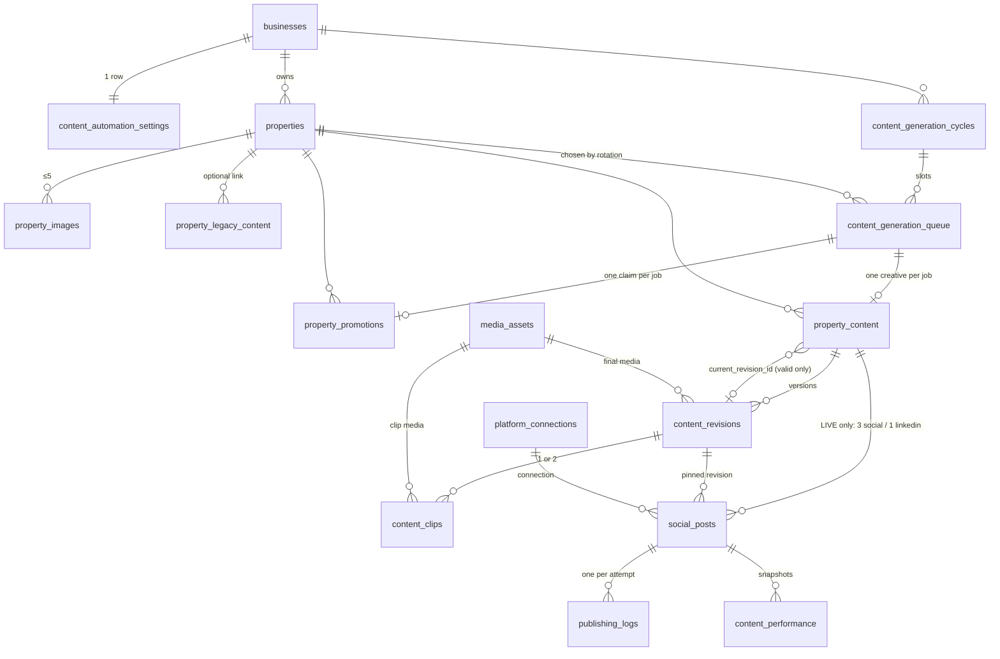

# Content Automation — Data Model & Safeguards

> **Status: migration prepared and validated locally; NOT yet applied to any Supabase project.**
> Source: `supabase/migrations/20261031000000_content_automation_schema.sql`. Product requirements: [`../kangrooo-content-automation-spec.md`](../kangrooo-content-automation-spec.md). Where this file and the spec disagree, this file reflects the migration (the spec's §15 table list was superseded — see "Deviations from the spec").
> What exists today is the **database layer, the publishing worker service, and the guarded API routes**. The generation agents, the weekly planner, the gallery UI and the Inngest wiring are **not built** (see "Not built yet").

## 1. The 12 new tables

| # | Table | Purpose |
|---|---|---|
| 1 | `properties` | The inventory (330 proposed). `source_key` is the stable import identity; `rotation_seq` is an append-only identity; `status` active/inactive. Location is city only — `region/country/timezone` stay NULL unless verified (`location_verified`). |
| 2 | `property_images` | Up to 5 reference URLs per property (`position` 1–5). `validation_status` `unchecked` (eligible) / `ok` / `broken` (disqualifies). |
| 3 | `property_legacy_content` | Imported spreadsheet history (blog / image post / video). **No FK into content or social_posts** — no path into publishing. |
| 4 | `content_automation_settings` | One row per business: two weekly frequencies (0–14), `automation_mode` (`testing`/`live` — the *currently selected* mode), `is_enabled` (paused when false), `generation_timezone` fallback, trigger-maintained `mode_changed_at/by`. |
| 5 | `content_generation_cycles` | One per business × environment × Monday week. `environment` is immutable. |
| 6 | `content_generation_queue` | One job per planned creative; lease (`locked_by/until`), attempts, backoff, `generation_state` JSONB for step progress. Environment is inherited from the cycle. |
| 7 | `property_promotions` | The rotation ledger: `claimed → generated \| failed \| released`. Only `generated` counts. Survives deletion of cycles/jobs. |
| 8 | `property_content` | The creative: identity + `environment` (immutable) + `current_revision_id` pointer + `archived_at`. |
| 9 | `content_revisions` | Every version (script, caption, hashtags, media, video format/duration, validation). A validated revision is frozen. |
| 10 | `content_clips` | Per-clip state of a video revision (1 clip for `single_30s`, 2 for `two_clip_40s`): provider task id, status, media, attempts, error. A completed clip is immutable → retries reuse it. |
| 11 | `publishing_logs` | One row per publish attempt (`started/succeeded/failed/unknown/blocked`) with the post's idempotency key and request/response metadata. |
| 12 | `content_performance` | Nullable engagement snapshots per published post. Unsupported metrics stay NULL. |

**`social_posts` is existing and is *modified*, not counted**: new nullable columns (`property_content_id`, `content_revision_id`, `platform`, `environment`, `hashtags`, `platform_metadata`, `schedule_timezone`, `platform_post_id`, `idempotency_key`, `publish_attempt_count`, `retry_base_attempt`, `next_attempt_at`, `publish_started_at`, `locked_by/until`, `publish_outcome_unknown`), statuses `held/cancelled/skipped` added, format `text_image` added. `property_content_id IS NULL` ⇒ a manual Social-module post; nothing about those rows changes.

**Derived, never stored:** `property_promotion_stats` (view, `security_invoker`) — per property × environment: generated / social / linkedin / failed-generation / in-flight counts, last generated (overall + per pipeline), content count, published-content count, last published.

### Existing Kinetix tables
- **Reused unchanged:** `businesses`, `business_users`, `profiles` (identity/RBAC), `media_assets` (all creative media), `platform_connections` (Upload-Post-backed accounts), `api_credentials`, `prompt_overrides`, `studio_sessions/messages` (creative studio), `upload_post_analytics_cache`.
- **Modified:** `social_posts` (above); policy `social_posts_write` replaced by `social_posts_write_manual`.
- **Untouched:** all Meta Ads tables (`campaigns`, `ad_sets`, `ads`, `leads`, `meta_ad_creatives`, `ad_performance_daily`, …).
- **Retained, not removed:** the Outreach tables/routes/jobs. Removal is a separate, dependency-checked step (see the report in the PR/summary); this migration drops nothing.

### Relationships (all business-scoped by composite foreign keys)

Every child carries `business_id` and references its parent through `(parent_id, business_id)` — a row can never point at another business's property, cycle, job, content or post. A revision belongs to its content (`(revision_id, property_content_id)` FK), including from `social_posts` and `content_clips`.

## 2. Testing vs Live

| | Testing | Live |
|---|---|---|
| Lives in | `property_content` + `content_revisions` + `content_clips` + `media_assets` | the same, **plus** `social_posts` rows |
| `social_posts` row | **never** (CHECK: `environment` may only be `live`; trigger rejects Testing content) | created only from a **valid, current revision** of Live content, status `scheduled`/`held` |
| Publishing | impossible | by the worker, after re-checks |
| Gallery regenerate | allowed | allowed only while the creative has **no** publishing records |

- `environment` is **immutable** on cycles, promotions, content and posts (trigger). A post's content/platform/environment/idempotency key are immutable too, and a manual post can never be converted into an automation post.
- One social creative → three posts (TikTok, Instagram, Facebook) sharing one revision (`UNIQUE (property_content_id, platform)`); LinkedIn creative (`text_image`) → exactly one LinkedIn post. LinkedIn never gets video (CHECKs on queue, content, and post).
- **Switching modes:** the settings trigger **holds** every `scheduled` Live post when automation goes Live→Testing *or* is paused, and **revalidates then releases** held posts on resume (`release_held_posts`): >6 h late, deactivated property, non-current/invalid revision ⇒ `skipped` with a reason. Old Testing content has no posts, so switching to Live can publish nothing historical.
- `automation_mode` stays the *selected* mode on the settings row (not renamed); every immutable per-record field is called `environment`.

## 3. State machines

**Generation (queue job):** `pending → processing → completed | failed | cancelled`. A retryable failure returns to `pending` with backoff, **lock cleared**, property claim kept. A job cannot be `completed` unless its creative exists, is `completed`, and has a valid current revision.

**Promotion claim:** `claimed → generated` (job completed) / `failed` (job permanently failed, or lease expired at max attempts) / `released` (job cancelled). Driven by a trigger on the queue, so no code path can forget it.

**`social_posts` (automation rows)** — enforced by trigger; `published`, `skipped`, `cancelled` are terminal:
```
scheduled → held | publishing | skipped | cancelled
held      → scheduled | skipped | cancelled
publishing→ published | failed | scheduled (known failure, backoff) | held | skipped
failed    → scheduled (retry_failed_publish) | cancelled
```
An **unknown** outcome keeps status `publishing` with `publish_outcome_unknown = true`; it is excluded from every claim and from `retry_failed_publish`.

## 4. Rotation — exact selection algorithm (`claim_property_for_job`)

Shared history across pipelines, per-pipeline fairness, environments independent. Selection is serialised per `(business, environment)` with `pg_advisory_xact_lock`, so concurrent jobs cannot pick the same property. A job that already has a property (a retry) keeps it.

**Eligible:** `properties.status = 'active'` **and** at least one image whose `validation_status <> 'broken'` (unchecked images are eligible; validate at generation time).

**Order (first difference wins), ascending:**
1. Not currently `claimed` by another in-flight job in this environment.
2. Not already `claimed`/`generated` in **this cycle** (avoid repeats while alternatives remain).
3. Fewest `generated` promotions in this environment, **all pipelines** (shared history).
4. Fewest `generated` for **this pipeline** (per-pipeline fairness).
5. Oldest `generated_at` for this pipeline (never-promoted first).
6. Oldest `generated_at` overall (never-promoted first).
7. `rotation_seq`, then `id` — fully deterministic.

Consequences (all covered by tests): a round visits every eligible property before any repeats; failed/claimed jobs never count as promotions; a **new** property (count 0) is picked next and does not reset anyone's history; a **deactivated** property is skipped but keeps its history, and re-enters by that history when reactivated; Testing and Live never mix; with 5 jobs and 3 eligible properties repeats are unavoidable within a cycle, and social slots (the larger pipeline) are assigned first. If nothing is eligible the job fails with `no eligible property`.

## 5. Publishing

Scheduling lives in the **database**, not on Upload-Post. The worker (`src/services/content-automation/publish.ts`) calls Upload-Post **immediately** (no `scheduledDate`) only after claiming a due post, so pausing or switching to Testing can always stop a post.

1. `recover_stale_publishing()` — a post stuck `publishing` past its lease is flagged **unknown** (never re-queued).
2. `claim_publish_jobs()` — first marks anything **>6 h late `skipped`** (`content_publish_max_lateness()`), then atomically claims due posts (`FOR UPDATE SKIP LOCKED`), bumps the attempt counter and inserts the `started` log row in one statement. A unique index allows at most one open attempt per post.
3. `publish_block_reason()` is the single definition of "publishable now": Live post, Live content, automation enabled **and** mode Live, property active, content not archived, post's revision is the current one **and** valid, connection present/`connected`/matching platform, not unknown, within 6 h. Used by the claim, by the worker **twice** (start + immediately before the call), by resume, and by retry.
4. Live connection health is checked on Upload-Post (`getProfile`) before sending.
5. Upload-Post ids are saved (`record_publish_response`) the instant the response arrives, before interpretation.
6. `finish_publish()` ends the attempt (stale/duplicate finishers are rejected): `published`; `failed` (retryable → `scheduled` with 5·n min backoff, capped at 3 per retry round, lock cleared; else `failed`); `unknown`; `blocked` (→ `held` for mode/pause, `failed` for connection trouble, `skipped` otherwise).

**Error classification:** a received 4xx (or a 2xx body saying failure) is a *definite* rejection (429 retryable); a network drop, timeout or 5xx **may have landed** → `unknown`. **Unknown is never retried.** `reconcileUnknownPosts` resolves it by the saved request/job id via Upload-Post's status endpoint, or a human calls `resolve_unknown_publish`. Residual risk (cannot be eliminated): Upload-Post has no idempotency key, so a crash in the instant between *its* acceptance and *our* saving the id leaves an unknown post with no id — those need manual review on the platform.

**Manual retry** (`retry_failed_publish`, authenticated editors): refuses unknown outcomes; re-queues; then re-runs `publish_block_reason`, rolling back if blocked. It re-times the post to now (a deliberate human retry gets a fresh 6 h window) and resets the auto-retry budget.

## 6. Who can do what (RLS + grants)

| Actor | Can |
|---|---|
| Any business member | **read** all 12 tables + the stats view for their business |
| editor+ | write `properties`, `property_images`; edit frequencies; manual `social_posts`; call `request_content_regeneration`, `retry_failed_publish` |
| **owner/admin only** | change `automation_mode` or `is_enabled` (trigger; also blocks an editor creating a Live/enabled settings row) |
| viewer | read only |
| other business | nothing |
| `anon` | nothing (grants revoked) |
| **service role** (Inngest, server) | all generation/publishing writes and every claim/finish function |
| authenticated users | **no direct writes** to cycles, queue, promotions, content, revisions, clips, logs, performance, legacy content; `social_posts_write_manual` only lets them touch rows with `property_content_id IS NULL`; claim/finish/reconcile functions are revoked from `anon`/`authenticated` |

`request_content_regeneration` is `SECURITY DEFINER` and authorizes the caller itself, so the gallery route runs on the **user's cookie session** (`/api/content/regenerate`) — no service-role key reaches the browser or the route. It only inserts a new **pending** revision; it never moves the current-revision pointer or creates a post, and a revision cannot become current until validated (all clips complete, media present).

## 7. Integrity & deletion

- Composite FKs enforce business ownership everywhere; weeks start on Monday; frequencies are 0–14.
- No history is cascaded away: every history FK is `RESTRICT` or `SET NULL (column)`. Deleting a cycle keeps promotions and content (pointers nulled). `businesses` → new tables is `RESTRICT` (a business with automation history cannot be deleted without an explicit purge procedure, **not written**). Disconnecting a platform account detaches automation posts instead of deleting them. Content is archived (`archived_at`), not deleted.
- Revisions: a validated revision is immutable; validation requires final media, the right number of completed clips (video), or text (LinkedIn).

## 8. Deviations from the spec's §15
`content_schedule` is **not** a table (the post *is* the schedule); `last_used_for_video`/`video_use_count`/`rotation_position` are **derived** (view / identity), not columns; `content_performance` hangs off `social_posts`; added `property_images`, `property_legacy_content`, `property_promotions`, `content_clips`; `automation_mode` on cycles became `environment`.

## 9. Not built yet
Weekly planner, social/LinkedIn generation agents, video orchestration (a worker must call `ensure_content_clip` per clip and `claim_generation_jobs/complete/fail/renew`), scheduling engine that creates the Live `social_posts`, the gallery/dashboard/settings UI, the Inngest functions that tick `runPublishBatch` / `reconcileUnknownPosts` (cron vs per-post event is an open decision — `CLAUDE.md` forbids adding recurring jobs without an explicit request), the `content/regenerate-requested` handler, and the Outreach removal.
