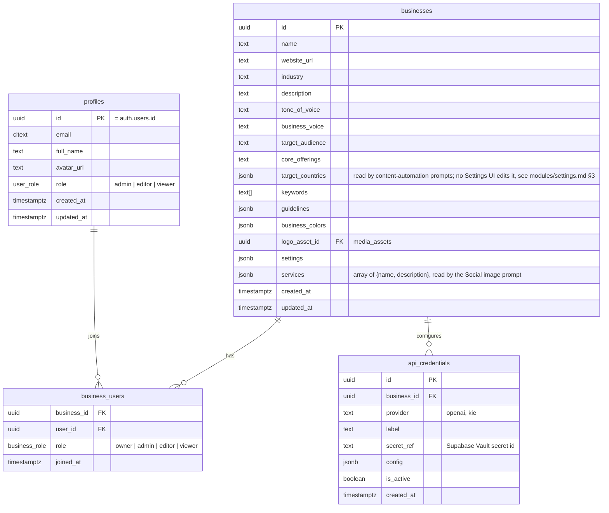
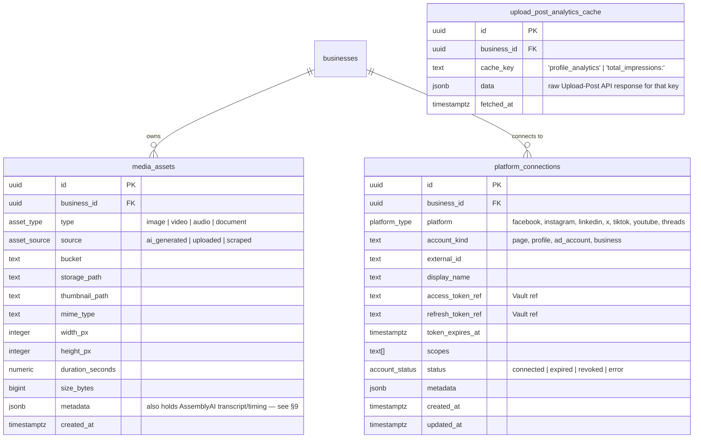
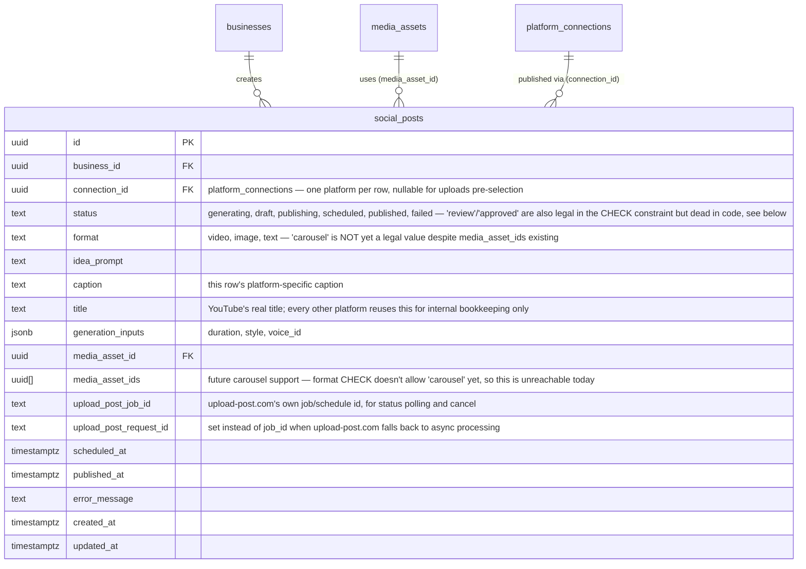

# Kinetix — Database Architecture & Data Flows

This describes the schema exactly as it exists live today — migrated and verified column-by-column against `supabase/migrations/`. It is not an idealized target; every column below is what's actually in the database right now. Two groups of tables exist: the **core** (§1–§7: users/businesses, media, platform connections, Social Media) and the **12 content-automation tables** (properties, rotation, generation queue, content, revisions, clips, publishing logs, performance), which are documented in full in [`content_automation.md`](content_automation.md) rather than repeated here. The Meta Ads (§3–6) and Outreach (§8) tables have been dropped.

**Multi-tenant-shaped, single-tenant in practice:** the tenant entity is `businesses`, with a `business_users` membership table, but the deployment runs with exactly **one** `businesses` row. See `system_design.md` §3 for the auto-enroll trigger that makes this cost nothing operationally.

## 0. Reading this document

A few things are worth knowing up front, because they're the result of deliberate decisions made while reconciling this schema against a real, already-working codebase — not oversights:

- **`social_posts` is one row per platform, not one row per post.** Posting the same creative to Instagram and TikTok is two rows sharing `media_asset_id`, each with its own `connection_id`, `caption`, and `status` — this is what lets "Instagram published, TikTok failed" be tracked as two independent outcomes instead of being unrepresentable.
- **Several tables carry column names from the original 2024 migration that predate this reconciliation** (`external_campaign_id` not `meta_campaign_id`, `account_kind` not `connection_type`, `access_token_ref`/`secret_ref` not `*_vault_ref`, `type` not `kind`). These were left as-is rather than renamed, since nothing was broken and renaming would be pure churn.
- **No RAG, no vector DB, no Pinecone.** AI features use direct context-window prompting

## 1. Core: Users & Businesses



`business_voice` and `tone_of_voice` are separate, both real — the former was added later specifically for AI-generation prompts (see `services/prompts/*.prompt.ts`), the latter predates it from the original design. Both exist; nothing consolidates them today.

See `system_design.md` §3 for the trigger that auto-enrolls every new profile into the single `businesses` row via `business_users`.

## 2. Media Library & Platform Connections



There's no stored `public_url` column on `media_assets` — public URLs are derived at request time via Supabase Storage's `getPublicUrl(bucket, storage_path)`, not persisted.

**`platform_connections` in practice today only has one real writer: Social Media, and only with `account_kind = "upload_post"`.** Accounts aren't connected via OAuth from Kinetix — they're connected by hand on upload-post.com's own dashboard; Kinetix's `/api/social/upload-post/sync` route mirrors that connection state into this table (plus the Facebook/LinkedIn Page IDs needed at publish time) purely for local display and lookup. The `access_token_ref`/`refresh_token_ref`/`scopes` columns shown above are part of the general-purpose shape but are unused by this writer — see `modules/social_media.md` §1 for the full mechanism. Content automation's (not yet scheduled) publishing worker checks the same rows for connection status before publishing.

**`upload_post_analytics_cache`** (added `20260806000000_upload_post_analytics_cache.sql`) is **unused**: nothing reads or writes it. It was built so the dashboards could avoid calling Upload-Post's analytics API live, but its refresh job was removed and both dashboard routes now call Upload-Post on every request (see `system_design.md` §2). The table was left in place rather than dropped.

## 3–6. Meta Ads — removed

The Meta Ads module (ad creative generation, paid campaign structure, nightly performance sync, Instant Form leads, AI Ad Studio) was removed when the product became posting automation only. Its tables — `meta_ad_creatives`, `campaigns`, `ad_sets`, `ads`, `ad_performance_daily`, `leads`, `studio_sessions`, `studio_messages` — and the `campaign_status` enum are dropped by `20261104000000_remove_meta_ads.sql`. Nothing else referenced them. `platform_connections` and `media_assets` are kept (Social/Content use them).

## 7. Social Media — built, real



One row = one platform: posting the same generated video to Instagram and TikTok creates **two** `social_posts` rows, sharing `media_asset_id` and `idea_prompt`, each with its own `connection_id`, `caption`, and `status` — see `modules/social_media.md`.

## 8. Outreach — removed

The entire Outreach schema (`outreach_lead_lists`, `outreach_leads`, `outreach_campaigns`, `outreach_campaign_leads`, `outreach_campaign_lists`, `email_events`) and `businesses.outreach_settings` were dropped by `20261101000000_remove_outreach.sql`, along with the Outreach module, its API routes, Inngest send job and the Instantly.ai/MillionVerifier integrations. The history of how it was built is in the earlier migrations.

## 9. Row Level Security

```sql
CREATE OR REPLACE FUNCTION public.user_business_ids()
RETURNS SETOF UUID LANGUAGE sql STABLE SECURITY DEFINER SET search_path = public AS $$
    SELECT business_id FROM business_users WHERE user_id = auth.uid();
$$;

CREATE OR REPLACE FUNCTION public.user_business_write_ids()
RETURNS SETOF UUID LANGUAGE sql STABLE SECURITY DEFINER SET search_path = public AS $$
    SELECT business_id FROM business_users
    WHERE user_id = auth.uid() AND role IN ('owner', 'admin', 'editor');
$$;

-- Applied to every business_id-scoped table:
CREATE POLICY social_posts_read ON social_posts
    FOR SELECT TO authenticated
    USING (business_id IN (SELECT public.user_business_ids()));

CREATE POLICY social_posts_write ON social_posts
    FOR ALL TO authenticated
    USING (business_id IN (SELECT public.user_business_write_ids()))
    WITH CHECK (business_id IN (SELECT public.user_business_write_ids()));
```

With one `businesses` row and every user auto-enrolled into it (`system_design.md` §3), these policies are trivially true for every authenticated user today. The moment a second business exists, isolation is already enforced without touching a single policy.

Inngest jobs write with the service-role key, which bypasses RLS entirely — expected, since it's the only way a background worker can write at all. Every job payload carries `businessId` explicitly; there's no session inside a worker to derive it from.

## 10. Media & Captions

`media_assets.metadata` holds per-asset details with no dedicated column. For content automation that includes the media probe (`metadata.probe`), the logo placement (`metadata.logo`), the LinkedIn image's text hook (`metadata.hook`) and the video end card (`metadata.endCard`); see `content_automation.md` §10.

## 11. History — how this schema got here

1. **`brands` → `businesses`.** Renamed the tenant table, added `business_users` + the auto-enroll trigger, renamed `connected_accounts`→`platform_connections`, `provider_credentials`→`api_credentials`, `ad_campaigns`/`ad_metrics_daily`→`campaigns`/`ad_performance_daily`, `meta_ad_intelligence`→`ad_analysis_reports`. Added `leads` and `social_posts` (new). Retired `posts`/`post_assets`/`post_metric_snapshots` in favor of `social_posts`, and a batch of already-dead tables.
2. **Forced down to exactly 14 tables (temporary — see below).** Dropped `newsletters`/`subscribers`/`newsletter_sends`/`newsletter_recipients`, all 6 `outreach_*` tables that existed at the time, `generation_jobs`, and `audit_logs`. Folded `meta_self_ad_metrics`'s columns into `ad_performance_daily`. Retired `meta_competitor_ads` entirely — the competitor scraper now dedupes/scores in memory within a single run instead of persisting a gallery.
3. **Terminology + cleanup.** Renamed `businesses.brand_voice`→`business_voice`, `brand_colors`→`business_colors`, cleaned up stale constraint names, dropped an orphaned column.
4. **Newsletter + Outreach schema added together** (`20260725000000_newsletter_outreach_schema.sql`) — shared `contacts`/`contact_categories`/`email_events` plus module-specific tables for both.
5. **Outreach campaign fields** (`20260726000000_outreach_campaign_fields.sql`) — added `service_type`/`target_region`/`cta_text`/`cta_link` to `outreach_campaigns`, made `category_id` (the predecessor to `list_id`) required.
6. **Outreach's own lead schema** (`20260727000000_leads_schema.sql`) — replaced the shared `contacts`/`contact_categories`/`outreach_campaign_contacts` with dedicated `outreach_leads`/`outreach_lead_lists`/`outreach_campaign_leads`, renamed the `contact_status` enum to `lead_status`.
7. **Newsletter schema dropped** (`20260728000000_drop_newsletter_schema.sql`) — that module wasn't being pursued; its tables and `newsletter_campaign_id`/enum remnants were removed rather than left half-built.
8. **`businesses.services`** (`20260729000000_business_services.sql`) — added as a plain array, then converted to the current `jsonb` `{name, description}[]` shape one migration later.
9. **`businesses.outreach_settings`** (`20260730000000_business_outreach_settings.sql`) — daily limit / timezone / send days / send window, JSON. Now editable via Settings → Automation Defaults (see #11 below); had no settings UI for one migration.
10. **Send window widened** (`20260731000000_outreach_send_window_24h.sql`) — default send window changed from business-hours-only to all-day, since a campaign sent outside the narrower window looked broken with no UI to explain why.
11. **`ad_sets.lifetime_budget_cents`** (`20260801000000_ad_sets_lifetime_budget.sql`) — lets an ad set use a Lifetime Budget (not just Daily) when its parent campaign isn't using Campaign Budget Optimization, mirroring the existing `campaigns.lifetime_budget_cents`.
12. **`businesses.video_reference_*`** (`20260803000000_business_video_reference.sql`) — adds `video_reference_enabled`/`video_reference_male_url`/`video_reference_female_url`. Replaced two hardcoded Cloudinary URLs in `src/services/ai/character-references.ts` with business-configurable uploads, and fixed a real bug where the male/female reference photos were being picked per product-area instead of per-gender (a female Meta Ads video always got the male photo, and vice versa for Social).
13. **`businesses.*_analysis_schedule_*`** (`20260804000000_business_analysis_schedules.sql`) — adds `competitor_analysis_schedule_day/hour/last_run_at` and `self_ad_analysis_schedule_day/hour/last_run_at` (day 0-6, hour 0-23, CHECK-constrained, both default Monday/0). Replaced the two analysis jobs' hardcoded weekly cron expressions with a per-business day/hour, checked hourly — see `system_design.md` §2.D.
14. **Dropped `chk_meta_ad_creatives_service`** (`20260805000000_drop_stale_service_check.sql`) — this CHECK constraint hardcoded 3 service names from an earlier single-service setup and was silently rejecting ad-creative-generation inserts for any newer/renamed service, now that `businesses.services` is business-configurable via Settings.
15. **`upload_post_analytics_cache`** (`20260806000000_upload_post_analytics_cache.sql`) — added so the Root/Social dashboards could stop calling Upload-Post's analytics API live (a measured ~several-second round trip), kept warm by a 5-minute Inngest job. **That job was later removed** — both dashboard routes now call Upload-Post live again on every request, by deliberate choice (see `system_design.md` §2's note on Leads/dashboards calling their APIs live). The table itself is still here, just unused.
16. **`ad_analysis_reports` dropped, plus its `businesses` schedule/config columns** (`20260816000000_remove_self_ad_competitor_analysis.sql`) — unlike #15 above, this one actually drops rather than just orphans: `ad_analysis_reports` (both `report_type`s), `businesses.competitor_analysis_schedule_day/hour/last_run_at`, `businesses.self_ad_analysis_schedule_day/hour/last_run_at`, `businesses.competitor_keywords`, and `businesses.ad_script_topics` are all gone, along with the two jobs, the Settings "Competitor Intelligence"/"Analysis Schedule" tabs, and every ad-generation prompt section that read either report type — the Meta Ads module itself was removed later (#17).

17. **Meta Ads removed** (`20261104000000_remove_meta_ads.sql`) — drops `studio_messages`, `ad_performance_daily`, `leads`, `studio_sessions`, `ads`, `ad_sets`, `campaigns`, `meta_ad_creatives` and the `campaign_status` enum.

18. **`businesses.video_reference_*` dropped** (`20261105000000_drop_video_reference.sql`) — the Social AI video pipeline that read them was removed; video is generated only by content automation.

19. **Outreach removed** (`20261101000000_remove_outreach.sql`). See §8.

20. **Content automation** (all applied; details in `content_automation.md`):
    - `20261031000000_content_automation_schema.sql`: the 12 tables, the `social_posts` extensions, rotation and publishing functions, RLS.
    - `20261102000000_content_manual_trigger.sql`: video format/duration on revisions, proposed schedules, `auto_run_enabled`, the manual "Generate now" trigger.
    - `20261103000000_content_cycle_week_plan.sql`: `content_generation_cycles.week_plan`.
    - `20261106000000_content_blog_pipeline.sql`: the display-only `blog` pipeline and `blog_frequency_per_week`.
    - `20261107000000_content_delete.sql`: `delete_content_item` (permanent gallery delete).
    - `20261112134926_content_trigger_exact_jobs.sql`: "Generate now" creates exactly the requested jobs.

## 12. Worked Examples

### A. Social Post (one row per platform)

```json
// social_posts — Instagram
{ "business_id": "b1…", "connection_id": "ig-conn…", "idea_prompt": "Day in the life at our space",
  "media_asset_id": "m9z…", "caption": "A day in the life at our space! Book your visit today. ✨",
  "status": "scheduled", "scheduled_at": "2026-07-20T10:00:00Z" }

// social_posts — TikTok (same shoot, independent row and status)
{ "business_id": "b1…", "connection_id": "tt-conn…", "idea_prompt": "Day in the life at our space",
  "media_asset_id": "m9z…", "caption": "Wait until the end... 😱 #venue #bts",
  "status": "scheduled", "scheduled_at": "2026-07-20T10:00:00Z" }
```

