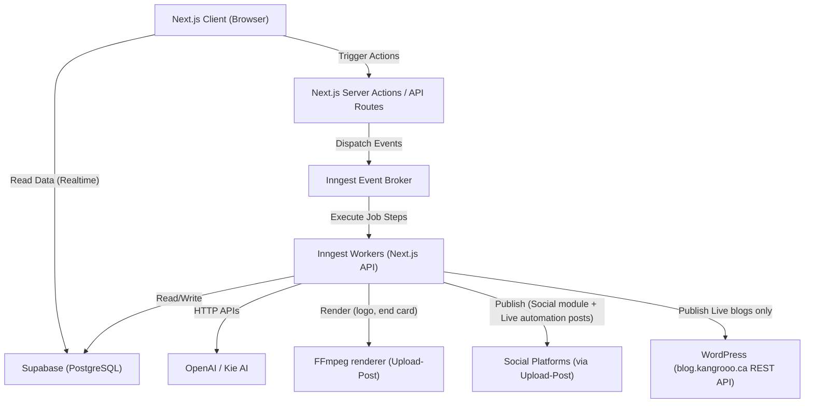

# System Design & Architecture

Kinetix follows a modern, serverless, event-driven architecture designed to handle long-running AI tasks without blocking the main web threads or running into serverless timeout limits.

**Tenancy:** the schema is multi-tenant-shaped (`businesses` + `business_users`), but Kinetix runs with exactly **one** `businesses` row today — there is one client. This is a deliberate choice: it costs nothing to operate single-tenant, and a second client later needs zero schema changes, just new rows. See §3.

## 1. High-Level Communication Flow



## 2. Component Responsibilities

### A. Next.js Frontend (App Router)
- **Responsibility:** UI rendering, routing, optimistic UI updates.
- **Data Fetching:** Direct database queries via `@supabase/ssr` (bypassing custom API routes), protected by Row Level Security (RLS). This enables fast reads and realtime subscription capabilities.

### B. Next.js Backend (Server Actions / API Routes)
- **Responsibility:** Secure operations only.
- **Usage:** Used *only* for things the client cannot do securely — chiefly, dispatching background events to Inngest (`inngest.send()`, e.g. `social/generate-image`) and calling third-party APIs with server-only secrets (Upload-Post) that a browser could never hold safely.
- **No inbound webhooks and no OAuth callbacks today.** Social Media never does OAuth itself — accounts are connected on Upload-Post's own dashboard (see `modules/social_media.md` §3). If either is ever added, it belongs in this layer.

### C. Supabase (Database & Auth)
- **Auth:** Supabase Auth only. RLS's `auth.uid()` requires Supabase-issued JWTs — there is no separate NextAuth session layer in this app.
- **Database:** PostgreSQL. Every piece of client data belongs to a `business`, not directly to a `user` — see §3. Users join a business via the `business_users` junction table.
- **Security:** RLS policies ensure a user can only read/write rows where a `business_users` row links their `auth.uid()` to that row's `business_id`. With one business today, every user simply has one `business_users` row (auto-created — see §3) — functionally equivalent to a simpler model, but the isolation is real and already enforced, not bolted on later.
- **Secrets:** provider keys (`OPENAI_API_KEY`, `KIE_API_KEY`, `UPLOAD_POST_API_KEY`, the WordPress application password `WORDPRESS_APP_PASSWORD`, …) are server-only environment variables read through `src/config/env.ts`. Nothing in `src/` reads Supabase Vault. The `api_credentials`/`platform_connections` `*_ref` columns exist in the schema but are unused, and Kinetix holds no social OAuth tokens because accounts are connected on Upload-Post (`modules/social_media.md` §3).

### D. Inngest (Background Job Engine)
- **Responsibility:** Managing long-running, error-prone tasks.
- **Why Inngest?** AI video generation (Kie AI) can take up to 3–5 minutes. Vercel serverless functions time out after 10–60 seconds. Inngest's step functions (`step.run`, `step.sleep`) pause execution, wait for the external job to finish, and resume — without holding a Vercel function open or hitting the timeout.
- **Canonical jobs.** The authoritative list is whatever's actually in the `functions` array exported from `src/services/inngest/functions.ts` — a function not in that array never registers, even if `createFunction(...)` exists elsewhere in the codebase. This table is that array, verified, not an idealized/proposed list:

| Job | Trigger | Event name / cron |
|---|---|---|
| Social post generation (image) | event | `social/generate-image` |
| Scheduled social post publish | event, one instance per scheduled post — not a recurring poll | `social/scheduled-post-created` |
| Content: claim queued jobs | event | `content/process-queue` |
| Content: generate one creative | event | `content/generate-job` |
| Content: gallery regenerate | event | `content/regenerate-requested` |
| Content: weekly cycle | cron | `TZ=America/Toronto 0 18 * * 5` (Fri 18:00) |
| Content: publish a Live social/LinkedIn post | event, one per post, timed for its `scheduled_at` | `content/publish-post` |
| Content: safety sweep (stale leases, lost events, missing posts, stalled queue) | cron | `*/15 * * * *` |
| Content: publish a Live blog to WordPress | event, one per Live blog, sent when it finishes generating (or on Retry / going Live) | `content/blog-publish` |

Two content functions are crons: the weekly cycle (acts only for a business with `auto_run_enabled`, which an owner/admin turns on in Automation) and the 15-minute safety sweep (cheap when there's nothing to do). Everything else is event-triggered on demand, or timed: each scheduled social post (manual or automation) gets one event at its publish time instead of a polling loop.

Every event payload carries `business_id` explicitly. Inngest functions run with the Supabase service-role key, which bypasses RLS entirely — scoping for background writes comes from the payload, never inferred from a session (there is no user session inside a background worker).


### The dashboards call their slow third-party APIs live, on every page load — by deliberate choice

The dashboards (now one Dashboard) used to read a 5-minute cache table fed by a background job; that job was removed on purpose — always-fresh data was judged more valuable than avoiding the real round trip (Upload-Post ~several seconds).

The dashboard routes call `UploadPostService.getProfileAnalytics`/`getTotalImpressions` directly, no cache table involved, and degrade to whatever they already have if the live call fails, rather than failing the whole page.

`upload_post_analytics_cache` still exists as a table (nothing currently reads or writes it) — left alone rather than dropped, since no one asked for it to be removed. That's not a universal rule, though: when a later cleanup explicitly asked to remove the (separate, unrelated) self-ad-analysis/competitor-analysis feature, `ad_analysis_reports` and its `businesses` schedule columns were actually dropped, not just orphaned — see `database_schema.md` §5. Whether to drop or just leave a removed feature's schema behind depends on what was actually asked for, not a fixed house style.

Don't reintroduce a background sync job for either of these without being asked — if page-load latency becomes a real problem again, restoring the cache pattern is a decision for whoever's asking to make explicitly. The underlying principle (a slow third-party API shouldn't block a passive page load by default) is still worth applying to any *new* integration; these two are documented, deliberate exceptions, not evidence the principle was wrong.

## 3. Tenancy Model

The schema is multi-tenant-shaped: every table hangs off `business_id`, and a `business_users` junction table links `auth.uid()` to the business(es) a user belongs to. Kinetix runs with **exactly one** `businesses` row today.

Running multi-tenant-shaped schema single-tenant costs nothing functionally — the one thing it requires is that every user actually gets enrolled in `business_users`, or RLS (§8 in `database_schema.md`) will correctly, but unhelpfully, show them nothing. That's closed with a trigger, mirroring the existing `on_auth_user_created` pattern that already auto-creates a `profiles` row:

```sql
CREATE OR REPLACE FUNCTION public.handle_new_user_business_membership()
RETURNS TRIGGER LANGUAGE plpgsql SECURITY DEFINER SET search_path = public AS $$
BEGIN
    INSERT INTO public.business_users (business_id, user_id, role)
    SELECT id, NEW.id, 'admin' FROM public.businesses LIMIT 1
    ON CONFLICT DO NOTHING;
    RETURN NEW;
END; $$;

CREATE TRIGGER on_profile_created_join_business
    AFTER INSERT ON public.profiles
    FOR EACH ROW EXECUTE FUNCTION public.handle_new_user_business_membership();
```

With this in place, onboarding a new team member needs no manual "add to business" step — they're enrolled automatically the moment their profile is created, same as today. Whenever a second `businesses` row is genuinely needed, this trigger's `LIMIT 1` is the one place that stops being correct — replace the auto-enroll with a real invite flow at that point. Nothing else in the schema changes.

A user's role comes from their membership row (`business_users.role`), not `profiles.role` (see `src/app/api/profile/route.ts` and `src/store/user.store.ts`). Content automation's RLS and `SECURITY DEFINER` functions use the same membership roles (editor+ / owner-admin); see `content_automation.md` §6.

## 4. Intelligence: no RAG, no vector DB

Every AI-facing feature in Kinetix (content-automation planning, review and blog writing, Social image prompts and captions) works by direct context-window prompting: the relevant business context is assembled into a single prompt and sent to OpenAI in one call. Kinetix does not use Pinecone or any vector store anywhere. The legacy n8n pipeline used a Pinecone-backed RAG step for its competitor-analysis feature; that was deliberately not carried forward when this app was rebuilt, and the feature itself (competitor analysis, plus a related self-ad-analysis job) was later removed from Kinetix entirely as unused — see `database_schema.md` §5. The RAG-vs-single-prompt reasoning still holds for anything AI-facing this app does today: the data volumes involved are small enough (a business's own context, one listing and its photos, one idea prompt) that retrieval isn't needed, and a single well-scoped prompt is simpler to build, debug, and reason about.

## 5. Dashboard — the one overview page

`/dashboard` (`src/modules/dashboard/`) is the app's landing page (`/` redirects to it). The page and the automation card show their own load errors; they never read as empty data. It is the **only** analytics page: the separate Social Analytics page was merged into it, and `/social` now redirects here. One call, `GET /api/dashboard?range=7d|14d|30d|90d|180d` (default `30d`; labels "7 days", "14 days", "1 month", "3 months", "6 months"), builds two halves that fail independently:

- **Social analytics, live from Upload-Post** on every load (see §2's note on dashboards calling their APIs live):
  - connection status;
  - profile analytics: followers, reach, engagement and its breakdown, the per-platform comparison and Instagram audience;
  - total impressions for the **exact** range (`start_date`/`end_date`). Upload-Post has no 14-day or 6-month preset, and the old preset mapping left the second week of "14 days" empty.
- **Content automation, from the database:**
  - mode, paused and weekly-runs state, and the next Friday 18:00 run;
  - the latest cycle's generated/target counts;
  - the next scheduled posts and blogs, and the recently published ones;
  - a **Needs attention** list: every failure or stuck state that needs a person, errors first, each with the latest underlying error. It covers automation posts and blogs, generation, the weekly run, manual Social posts, accounts, configuration, and this route's own load failures. The full list is in `content_automation.md` §15.

The page, top to bottom:
1. **Needs attention** (only when non-empty);
2. KPI row: followers, impressions (range), reach, engagement, connected accounts;
3. impressions trend (range) next to the engagement breakdown;
4. platforms by followers next to impressions by platform (range);
5. **Content Automation**;
6. platform health;
7. Instagram audience (when there's data).

Only impressions follow the range. Followers, reach and engagement are what each platform reports now, and the tiles say so. Facebook impressions are overstated over a range (Upload-Post sums Facebook's rolling 30-day daily figure), and the per-platform card notes it.

## 6. Shared Pagination System

Every list page (Social Posts, Listings, the Content Gallery) uses one shared pagination contract instead of each inventing its own:

- **`src/lib/pagination.ts`** — the only two allowed page sizes, `PAGE_SIZE_COMPACT` (10, for tables and low-density grids) and `PAGE_SIZE_DENSE` (20, for denser card/thumbnail grids) — picked per page based on roughly how many items its layout shows per viewport, never a bespoke number. Plus three helpers: `paginationMeta(total, page, limit)` (returns `{ total, page, limit, totalPages }`, floored at 1 page), `rangeFor(page, limit)` (the `[from, to]` tuple for Supabase's `.range()`), and `paginateArray(items, page, limit)` (in-memory slicing for the one list that can't be paginated at the query level — see below).
- **`src/components/ui/Pagination.tsx`** — the one Prev/1…N…Last/Next control every paginated page renders, with page-number condensation (always page 1 and the last page, plus current±1, collapsing any gap into a single "…").
- **API contract:** every query-level paginated route reads `page`/`limit` query params and returns its data array plus `pagination: paginationMeta(...)` (e.g. `{ listings, pagination, categories, counts }` from `/api/listings`, `{ items, pagination }` from `/api/content/gallery`).
- **Page sizes in use:** Listings uses `PAGE_SIZE_COMPACT` (10). The Content Gallery uses its own `PAGE_SIZE = 12` (`GalleryPage.tsx`), an exception to the two-size rule.
- **Client hooks** use TanStack Query's `keepPreviousData` so switching pages doesn't flash a loading skeleton — the previous page's rows stay visible until the next page resolves.

**The one exception — Social Posts is paginated in-memory, not at the query level.** A `social_posts` row exists per *platform a post targets*, not per logical post — one post published to 3 platforms is 3 rows, tied together only by a shared `media_asset_id` (or, for text posts with no media, a `created_at`+`idea_prompt` coincidence — see `modules/social_media.md` §8). Slicing raw rows with `.range()` could split one post's rows across two pages. So `Posts.tsx` fetches all rows (still a lightweight query), groups them client-side into `PostGroup[]` (existing logic, unchanged), then applies `paginateArray()` to the *grouped* list before rendering. This is the one page in the system that doesn't reduce its initial fetch size via pagination — a real, currently-accepted trade-off. Fixing it at the query level would need a schema change (a real `post_group_id` stamped at creation time for both image/video and text posts), which is a worthwhile follow-up but out of scope for the pagination pass that added this system.

## 7. Shared Dashboard UI Kit

`src/components/global/DashboardKit.tsx` is the one file the Dashboard is built from (it was shared by the former Root and Social dashboards before they were merged). It exports:
- A fixed color system (`ACCENT` — purple/blue/green/amber/red, mapped to `DESIGN.md`'s tokens) and `CHART_SERIES`, a categorical color order that's never re-picked per chart (per the dataviz convention: color follows the entity, not its rank).
- `chartTickInterval(pointCount, targetLabels = 7)` — scales a chart's x-axis label interval to the actual number of data points, so labels never overlap regardless of how long a selected date range is (replacing an earlier fixed-threshold approach that broke down for very long ranges).
- Layout primitives: `Card`, `SectionTitle`, `KpiTile` (compact/tint/default variants), `EmptyState`.
- A matching family of loading skeletons — `KpiRowSkeleton`, `AreaChartSkeleton`, `PieChartSkeleton`, `BarRowsSkeleton`, `ProportionalListSkeleton`, `TableSkeleton`, `ModuleCardSkeleton`, and more — each built on the real `Skeleton` primitive (`src/components/ui/skeleton.tsx`) and shaped to mirror its corresponding real component's exact layout, so nothing visibly reflows once real data arrives. The same principle extends beyond dashboards: every list/detail page in the app (Listings, the Content Gallery and its drawer, Social Posts) follows the same rule — real static chrome (headers, breadcrumbs, known labels) renders immediately, and only the genuinely data-dependent parts shimmer.
